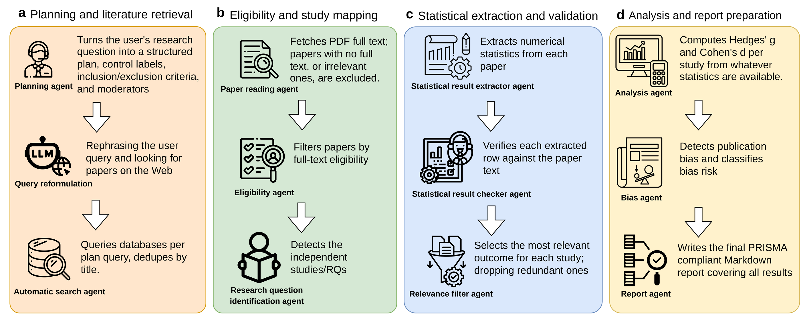

<div align="center">

# AutoSynthesis

**An agentic system for automated meta-analysis**

From a research question to a PRISMA-aligned meta-analysis report: literature search, screening,<br>
full-text eligibility, statistical extraction, effect sizes, random-effects pooling, heterogeneity,<br>
publication bias and risk-of-bias assessment.

[](https://arxiv.org/abs/2607.15247)
[](https://auto-synthesis.com)
[](LICENSE)




</div>

---

## Contents

| Folder | What it contains |
|---|---|
| [`app/`](app) | The AutoSynthesis system: LangGraph agents, statistics engine (R `metafor`), web app, Docker setup, tests |
| [`benchmark/`](benchmark) | Benchmark against 100 Cochrane reviews: data, per-review outputs, and the scripts that reproduce the benchmark results and figures |
| [`case_studies/`](case_studies) | The three example meta-analyses shown in the paper (prompt, outputs and figures) |

## Reproduce the paper's results

No API key and no LLM calls are needed. All model outputs are included in the repository.

```bash
pip install -r benchmark/requirements.txt
bash benchmark/reproduce.sh
```

This takes about a minute and writes:

* `benchmark/figures/`: the benchmark figures (PDF)
* `benchmark/results/`: per-review comparison table (`benchmark_audit_per_review.csv`) and summary metrics (`benchmark_summary.json`)

See [`benchmark/README.md`](benchmark/README.md) for the data, the metrics and which script makes which figure.

## Run AutoSynthesis

AutoSynthesis calls its language models through [OpenRouter](https://openrouter.ai), so you need an OpenRouter API key.

```bash
cd app
cp .env.example .env            # add OPENROUTER_API_KEY (and optional search API keys)
docker compose up --build -d
docker compose --profile tools run --rm db-migrate   # first start only: creates the database tables
```

Open <http://localhost:8000>, then either:

* **Search mode**: type a research question. AutoSynthesis plans the review, searches the literature databases, screens the records, retrieves the full texts and runs the meta-analysis.
* **Manual mode**: upload the PDFs of the studies to include, together with the research question.

The run pauses at review gates, where you can check the selected papers and the extracted data before the analysis continues. The **Demo** button loads the three case studies without any API calls.

<details>
<summary><b>Run without Docker</b></summary>

Requires Python 3.11+ and R with the `metafor` package.

```bash
cd app
pip install -r requirements.txt
python -m playwright install chromium   # browser fallback for full-text retrieval
cp .env.example .env                    # add OPENROUTER_API_KEY
python dashboard.py                     # http://localhost:8000
```

Without `DATABASE_URL` and `REDIS_URL`, the app keeps run state in memory.
</details>

<details>
<summary><b>Run the tests</b></summary>

```bash
cd app
OPENROUTER_API_KEY=dummy python -m pytest tests -q
```

The tests mock every LLM call; tests that need live services are skipped.
</details>

## How it works

AutoSynthesis is a graph of specialised LLM agents (built with [LangGraph](https://github.com/langchain-ai/langgraph)). Every agent writes its decisions and intermediate results to the run folder, so each step can be audited.

| Stage | Agents | Main outputs |
|---|---|---|
| **a. Planning and retrieval** | planning, query reformulation, search | `plan.json`, search queries, found records |
| **b. Eligibility and study mapping** | screening, paper reading, eligibility, research-question and study detection | `study_screening.csv`, `paper_tracking.csv` |
| **c. Statistical extraction and validation** | statistical result extractor, statistical result checker, relevance filter | `meta_ready_results.json` |
| **d. Analysis and report** | analysis (effect sizes and random-effects pooling), moderator, bias (publication bias, RoB 2 / ROBINS-I), report, PRISMA | `effect_sizes.json`, `meta_analysis_result.json`, figures, `meta_analysis_report.md` |

The language models do not calculate the statistics. The pooling, heterogeneity, Egger's test, trim-and-fill and leave-one-out analyses are computed with R [`metafor`](https://www.metafor-project.org) (REML random effects), in [`app/statistics/`](app/statistics).

## Citation

```bibtex
@misc{taherinezhad2026autosynthesis,
  title     = {AutoSynthesis: An agentic system for automated meta-analysis},
  author    = {Taherinezhad, Moein and Maier, Sebastian and Vitagliano, Gerardo and Pierri, Francesco and Feuerriegel, Stefan},
  year      = {2026},
  publisher = {arXiv},
  doi       = {10.48550/arXiv.2607.15247},
  url       = {https://arxiv.org/abs/2607.15247}
}
```

## License

[MIT](LICENSE)
